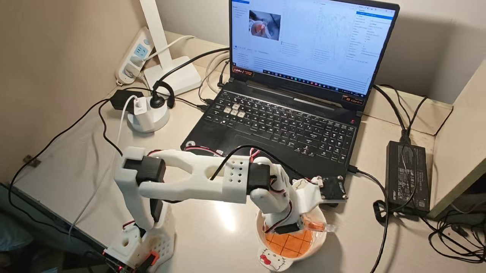
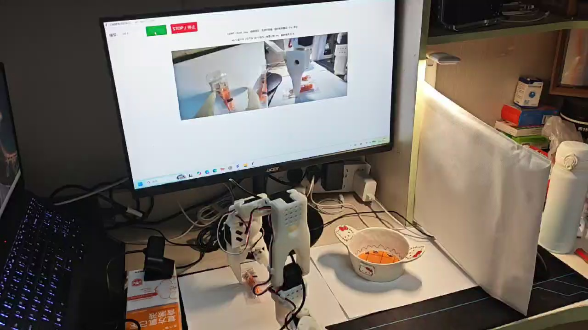

# SO-101 桌面抓取与放置：ACT 与 π₀.₅

基于 LeRobot 的真实机械臂项目，覆盖 **数据采集 → 数据适配 → 策略训练 → 真机推理**。
ACT 完成单视角小物体抓取与放置；π₀.₅ 使用前视与侧视图像，面向两个透明包装耳塞依次抓取入碗的任务。

## 真机演示

| ACT | π₀.₅ |
| --- | --- |
| [](videos/act-demo.mp4) | [](videos/pi05-demo.mp4) |
| [观看 ACT 真机视频](videos/act-demo.mp4) | [观看 π₀.₅ 真机视频](videos/pi05-demo.mp4) |

视频由项目作者提供，原文件无修改。视频展示单次执行，不等同于多轮成功率评测。

## 实验配置

| 项目 | ACT | π₀.₅ |
| --- | --- | --- |
| 示范 / 帧数 | 30 / 8,234 | 50 / 21,538 |
| 相机 | 前视，640×480，30 FPS | 前视＋侧视，640×480，15 FPS |
| 状态 / 动作 | 6 维（含夹爪） | 6 维（含夹爪） |
| 任务 | 小物体抓取入碗 | 两个耳塞依次抓取入碗 |
| 布局变化 | 未声明随机化评测 | 示范间对物体与碗的位置作小幅随机化 |
| 训练 | batch 4，20,000 次更新，约 9.7 epoch | 有效 batch 4，37,695 次更新，7 epoch |
| 硬件 | RTX 3060 Laptop 6GB | 单 RTX 4090 训练 3 轮，再双卡续训 4 轮 |

π₀.₅ 仅微调动作专家，使用 BF16、梯度检查点与梯度累积。双卡阶段保持有效 batch 为 4，逐轮保存检查点。
最终目录名 `075383` 是切换并行规模后的批次计数，**不是参数更新总数**。

## 数据与部署

- **采集**：主从臂遥操作，同步记录图像、关节状态与动作；π₀.₅ 每段包含两个物体连续夹取与放置。
- **适配**：核对图像字段及关节顺序，按观测起点提取动作块；ACT 使用自身处理器，π₀.₅ 使用分位数归一化及维度补齐，动作块长度 50。
- **训练**：ACT 使用 ResNet-18 视觉特征和关节状态；π₀.₅ 在预训练模型上进行动作专家微调。
- **推理**：ACT 使用原生 `lerobot-rollout`；π₀.₅ 由服务器接收双视角观测并返回动作块，本地执行。

## 开始使用

1. 阅读 [安装与来源](docs/setup.md)，准备独立 Python 环境。
2. 按 [ACT 操作说明](act/README.md) 配置自己的机械臂端口、标定 ID 和相机。
3. 按 [π₀.₅ 操作说明](pi05/README.md) 准备数据和模型，再运行训练或推理。

```text
act/                  ACT 采集、训练、原生推理命令
pi05/configs/         双视角训练配置
pi05/scripts/         实验训练脚本及服务器推理脚本
pi05/remote_metadata/ 远程客户端配置（不含权重）
videos/               两段真机演示原视频
evidence/             实验数字、视频校验值、服务器依赖版本
third_party/lerobot/  服务器实际使用的 LeRobot 源码快照
```

## 复现范围

仓库提供实验脚本、配置和演示。**训练数据、微调权重及设备标定不在仓库中**，使用者需自行准备。
50 段双视角数据全部用于训练，未在该版本中进行独立测试集成功率评测。
视频、训练结束与推理 HTTP 成功均不能替代泛化评测；不声称模型间成功率优劣。
发布整理时未重新训练，也未运行机械臂。新增的路径配置和客户端适配需在自己的硬件上重新验证。

## 致谢与许可

基于 [LeRobot](https://github.com/huggingface/lerobot)、[Seeed LeRobot](https://github.com/Seeed-Projects/lerobot) 与 [Physical Intelligence](https://github.com/Physical-Intelligence/openpi) 的开放工作。
本项目贡献在于 SO-101 数据适配、实验训练、远程部署与真机联调，不宣称原创 ACT 或 π₀.₅ 算法。
第三方源码保留原版权与 [Apache-2.0 许可](third_party/lerobot/LICENSE)。预训练模型遵守各自模型许可；本仓库不重新分发模型权重。
